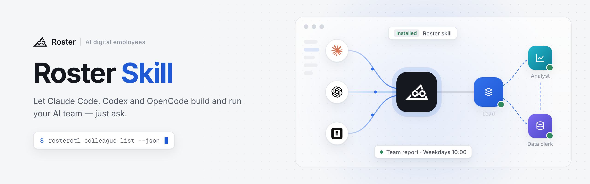

<p align="center">
  <picture>
    <source media="(prefers-color-scheme: dark)" srcset="assets/banner-dark.png">
    
  </picture>
</p>

<p align="center"><b>English</b> | <a href="README.zh-CN.md">简体中文</a></p>

# Roster Skill

Let Claude Code, Codex, OpenCode and other AI tools build and run your [Roster](https://memorylake.ai/roster) digital employees.

Roster is the desktop app that runs AI digital employees on your own computer, in Feishu, WeCom, DingTalk, Slack or Telegram.
This skill teaches your AI tool to operate it through the `rosterctl` command that ships with Roster.

## What it can do

- **Check on everything**: which employees are online, what needs attention, and how to fix it
- **Set up an employee from scratch**: pick an IM account, a brain and a model, create it, start it, run a health check
- **Build a team**: several employees split the work in a collaboration group, and a lead reports back to you
- **Write scheduled tasks**: daily reports, weekly reviews, routine checks, alert triage — validated first, with the next few run times shown for you to confirm
- **Set group reply rules, switch skills on or off, enable memory**

Your AI never handles keys, QR scans or wider permissions. For those it opens the right page in the Roster desktop app and hands the step back to you.

## Before you start

1. Install the Roster desktop app: [memorylake.ai/roster](https://memorylake.ai/roster).
2. In the app's sidebar, open **Use Roster in AI tools** and click **Install all**. This installs the `rosterctl` command and adds this skill to the Claude Code, Codex and OpenCode found on your computer, so you can skip the next section.

## Install manually

**Claude Code**

```
/plugin marketplace add memorylake-ai/roster-skill
/plugin install roster@roster
```

**Codex**

```bash
git clone https://github.com/memorylake-ai/roster-skill.git
mkdir -p ~/.codex/skills && cp -R roster-skill/skills/roster ~/.codex/skills/
```

**OpenCode**

```bash
git clone https://github.com/memorylake-ai/roster-skill.git
mkdir -p ~/.config/opencode/skills && cp -R roster-skill/skills/roster ~/.config/opencode/skills/
```

OpenCode also reads `~/.claude/skills/`, so if you already installed it for Claude Code by hand you can skip this.

**Other tools that support Agent Skills**: copy the whole `skills/roster/` folder into that tool's skills folder.

## Try it

Once installed, just ask your AI tool in plain words, for example:

- *Set up an operations team: a data clerk exports order data daily, an analyst writes conclusions, and a lead reports to me at 10 am on weekdays.*
- *Check whether all my digital employees are online, and find out why if any aren't.*
- *Create an automation for the operations assistant that writes a daily report at 6 pm on weekdays.*

The AI shows you a plan first and acts after you confirm. The skill's instructions are written in Chinese; the AI replies in your language.

## Version alignment

`SKILL.md` states the **rosterctl API version** the skill needs. `contracts/rosterctl-api-<N>.json` is the contract for that version (from `rosterctl contract --json`);
CI runs `scripts/check-contract.mjs` to make sure every command and flag the skill mentions exists in the contract, and also checks against the latest released desktop app.

## License

Apache-2.0
