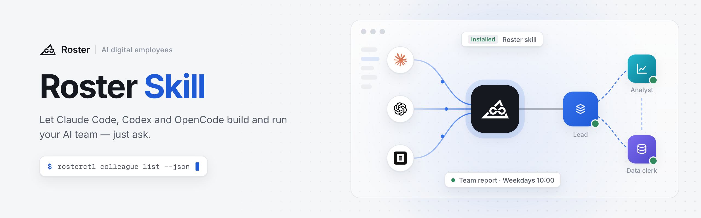

<p align="center">
  <picture>
    <source media="(prefers-color-scheme: dark)" srcset="assets/banner-dark.png">
    
  </picture>
</p>

<p align="center"><a href="README.md">English</a> | <b>简体中文</b></p>

# Roster Skill

让 Claude Code、Codex、OpenCode 等 AI 工具帮你搭建和管理 [Roster](https://memorylake.cn/roster) 数字员工。

Roster 是在你自己电脑上运行 AI 数字员工的桌面客户端，员工在飞书、企业微信、钉钉、Slack 或 Telegram 里上岗。
本技能教会你的 AI 工具通过 Roster 自带的 `rosterctl` 命令来操作它。

## 它能做什么

- **看全貌与体检**：哪些员工在线、哪里需要处理、怎么修
- **从零搭一名员工**：选 IM 账号、大脑和模型，建好、启动、体检
- **搭一个团队**：几名员工在协作群里分工，负责人汇总后向你汇报
- **写自动任务**：日报、周复盘、定时巡检、群里收到告警时分析 —— 写完先校验，把接下来几次的运行时刻给你确认
- **设置群聊回应、开关技能、开通记忆**

需要密钥、扫码授权、放开权限的事，AI 不会经手：它会让 Roster 桌面端打开对应页面，由你来完成。

## 开始之前

1. 安装 Roster 桌面端：[memorylake.cn/roster](https://memorylake.cn/roster)（国际：[memorylake.ai/roster](https://memorylake.ai/roster)）。
2. 在桌面端左侧导航打开「**在 AI 中使用 Roster**」，点「**全部安装**」：装好 `rosterctl` 命令，并把本技能装进本机检测到的 Claude Code / Codex / OpenCode —— 这样就不用再看下面的「手动安装」。

## 手动安装

**Claude Code**

```
/plugin marketplace add memorylake-ai/roster-skill
/plugin install roster@roster
```

**Codex**

```bash
git clone https://github.com/memorylake-ai/roster-skill.git
mkdir -p ~/.codex/skills && cp -R roster-skill/skills/roster ~/.codex/skills/
```

**OpenCode**

```bash
git clone https://github.com/memorylake-ai/roster-skill.git
mkdir -p ~/.config/opencode/skills && cp -R roster-skill/skills/roster ~/.config/opencode/skills/
```

OpenCode 也会读 `~/.claude/skills/`，已经给 Claude Code 手动装过的可以不再装。

**其他支持 Agent Skills 的工具**：把 `skills/roster/` 整个目录放到该工具的技能目录里。

国内访问 GitHub 不稳定时，用桌面端的「全部安装」即可：取不到 GitHub 会自动改用安装包里自带的技能。

## 试一下

装好后，在 AI 工具里直接用大白话说，比如：

- 「帮我搭一个运营团队：数据员每天导出订单数据，分析员写结论，负责人每个工作日 10 点向我汇报」
- 「看看我的数字员工都在不在线，有问题帮我查原因」
- 「给运营助理建一个每个工作日 18 点写日报的自动任务」

AI 会先给你看计划，你确认后再动手。

## 版本对齐

技能在 `SKILL.md` 里写明需要的 **rosterctl 接口版本**。`contracts/rosterctl-api-<N>.json` 是该版本的接口契约（来自 `rosterctl contract --json`）；
CI 用 `scripts/check-contract.mjs` 检查技能里写到的每条命令、每个参数都在契约里，并另外对照最新发布的桌面端。

## License

Apache-2.0
